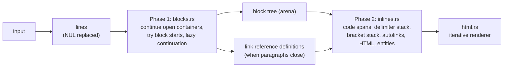

# marksman

A dependency-free CommonMark 0.31.2 parser and HTML renderer in Rust. Its output is
byte-identical to the spec on all 652 examples, it runs in linear time on cmark's
pathological inputs, and it has been fuzzed for 3 million runs.

[](https://github.com/eshaan2418/marksman/actions/workflows/ci.yml)
[](LICENSE)


```
$ make demo
# marksman

A *CommonMark* parser: **652/652** spec examples.

- lists
- `code`

> quotes and [links](https://commonmark.org "CommonMark")
<h1>marksman</h1>
<p>A <em>CommonMark</em> parser: <strong>652/652</strong> spec examples.</p>
<ul>
<li>lists</li>
<li><code>code</code></li>
</ul>
<blockquote>
<p>quotes and <a href="https://commonmark.org" title="CommonMark">links</a></p>
</blockquote>
```

## Why this exists

Markdown looks simple and is not. Emphasis follows a 17-rule delimiter algorithm, list items
decide tightness by looking at blank lines two levels down, and link reference definitions can
appear anywhere a paragraph starts. Most hand-written Markdown parsers get dozens of spec
examples wrong, and many go quadratic on input like `[[[[…` or `*a **a *a …`. That turns a
Markdown preview into a denial-of-service vector. marksman implements the spec's two-phase
algorithm exactly, proves it on the full official test suite, and treats adversarial inputs as
tests rather than afterthoughts.

## Highlights

- **652/652 spec examples, byte for byte.** The test fetches the official `spec.json`
  (checksum-verified) and requires exact HTML equality, with no normalisation.
- **Linear time on adversarial input.** 17 pathological patterns (cmark's categories: nested
  emphasis, unclosed links and backticks, 50k nested block quotes, thousands of reference
  definitions) scale with ratio ≈ 4 for 4x input. Four quadratic paths were found this way and
  fixed (see DEEP_DIVE §8).
- **No recursion on the input.** Block structure, inline processing, rendering, and
  `Document::walk` are all iterative, so 80,000 nested block quotes or emphasis levels cannot
  overflow the stack.
- **Spec-exact details.**
  - The delimiter-run algorithm with the "multiple of 3" rule.
  - Unicode punctuation (P and S categories) for flanking, from generated tables.
  - Unicode case folding for link labels, and all 2,125 HTML5 entities.
  - Tabs as partial columns inside list items, and seven HTML block kinds.
- **Zero dependencies.** It needs no regex crate: the HTML-tag, autolink, and block-start
  grammars are hand-written scanners.

## Quick start

```sh
git clone https://github.com/eshaan2418/marksman && cd marksman
make test     # fetches the spec, runs 652 examples + unit + pathological tests
make demo
cargo run --release -- README.md > README.html
```

Requires Rust 1.88+ (edition 2024). Works on any platform Rust supports.

## Usage

```rust
let html = marksman::to_html("Hello *world* — see [the spec](https://spec.commonmark.org)\n");
assert_eq!(html, "<p>Hello <em>world</em> — see <a href=\"https://spec.commonmark.org\">the spec</a></p>\n");

// Walk the tree, e.g. to collect headings for a table of contents.
use marksman::{Document, Event, NodeValue};
let doc = Document::parse("# A\n\ntext\n\n## B\n");
let mut levels = vec![];
doc.walk(|e| if let Event::Enter(NodeValue::Heading { level }) = e { levels.push(*level) });
assert_eq!(levels, [1, 2]);
```

CLI: `marksman [FILE]` reads a file or stdin and writes HTML to stdout.

## Architecture



**Phase 1** processes the input line by line:
1. walk the open containers (block quotes, list items), matching each line prefix;
2. try new block starts on what remains;
3. otherwise lazily continue an open paragraph, or close the unmatched blocks;
4. append the rest of the line to the innermost leaf.

When a paragraph closes, link reference definitions at its start are extracted.

**Phase 2** parses the text of every paragraph and heading with a delimiter stack (emphasis)
and a bracket stack (links and images) over a doubly linked node list, so wrapping a run of
nodes in `<em>` or `<a>` is O(1) per node.

[docs/DESIGN.md](docs/DESIGN.md) covers each phase. [docs/DEEP_DIVE.md](docs/DEEP_DIVE.md)
answers the hard questions.

## Benchmarks

Parse + render throughput (criterion, CommonMark mode, no extensions) against pulldown-cmark
0.13.3 and comrak 0.47.0.
- Hardware: Apple M5 Pro, Rust 1.99.1.
- Machine load: other jobs were running (load average 11–15), so absolute numbers are
  depressed; all three were measured in the same run.
- Corpora (`scripts/make_corpus.sh`):
  - `docs.md`: the READMEs and docs of my published repos, ×8 (1.35 MB);
  - `spec.md`: all 652 spec examples concatenated, ×8 (130 KB, feature-dense).
- Raw output: `bench/results/criterion.txt`.

| corpus | marksman | pulldown-cmark | comrak |
|---|---:|---:|---:|
| docs.md (prose) | 115 MiB/s | **398 MiB/s** | 127 MiB/s |
| spec.md (dense) | 37.5 MiB/s | **80.2 MiB/s** | 25.5 MiB/s |

Spec examples whose HTML is **byte-identical** to the spec (`bench/results/conformance.txt`):

| marksman | pulldown-cmark | comrak |
|---:|---:|---:|
| 652/652 | 630/652 | 580/652 |

What the numbers say:

- **pulldown-cmark is 2–3.5x faster.** It is a pull parser that streams events without
  building a tree and renders directly from them. marksman builds an arena tree, as cmark and
  commonmark.js do, which costs allocations but makes traversals like `walk` possible.
- **marksman matches comrak** on prose and is 1.5x faster on feature-dense input.
- **The conformance counts are byte-exact comparisons.** The official spec runner normalises
  HTML (whitespace and attribute formatting) before comparing, so these numbers are not a claim
  that the other libraries mis-parse those examples. They show only that marksman reproduces
  the reference output exactly.

Reproduce: `make bench`.

## Design decisions and trade-offs

- **The reference algorithm, not a rewrite.** Phase 1 follows the spec's appendix (the
  commonmark.js and cmark design) line for line in structure. Fidelity mattered more than
  novelty, and the spec suite is the arbiter.
- **An arena tree with sibling links.** Node ids instead of `Rc<RefCell<…>>`: cache-friendly,
  no reference counting, and O(1) unlink and insert for emphasis and link wrapping.
- **Hand-written scanners instead of `regex`.** No dependency, and each scanner is written to
  its grammar (open tags, comments, autolinks), with unit tests.
- **Memoisation for pathological inputs** instead of resource limits. Unmatched backtick runs
  and unclosed link destinations remember what a failed scan proved, so later attempts answer in
  O(1). Output stays exactly spec-conformant.
- **Generated tables.** Unicode punctuation, Unicode whitespace, and HTML5 entities are
  generated by scripts from Python's `unicodedata` (Unicode 15.0) and the WHATWG
  `entities.json`, and binary-searched.

## Testing

- **Spec**: all 652 CommonMark 0.31.2 examples, exact HTML equality (`tests/spec.rs`).
- **Pathological**: 17 adversarial patterns at 20k and 80k sizes. The time ratio must be under
  10 (linear is 4), and nothing may overflow the stack (`tests/pathological.rs`, release mode).
- **Fuzzing**: `cargo fuzz` with the spec examples as seeds. No panics and deterministic
  output, 3,019,908 runs in 5 minutes locally (`bench/results/fuzz.txt`), plus 60 s in CI.
- **Unit tests**: entities, URL normalisation, label folding, tag and autolink scanners, and
  HTML block conditions.
- CI on macOS and Linux runs `cargo fmt --check`, `clippy -D warnings`, all tests, and the fuzz
  job.

## Limitations and roadmap

- CommonMark only: no GFM tables, task lists, strikethrough, footnotes, or autolinks without
  angle brackets.
- No source positions on nodes and no streaming or event API.
- 2–3.5x slower than pulldown-cmark. The next steps are fewer `String` allocations for text
  nodes (borrowed slices), and rendering directly from the arena without cloning literals.
- Roadmap: GFM extensions behind feature flags, source positions, and a `pulldown-cmark`-style
  event iterator over the arena.

## Project structure

```
src/blocks.rs     phase 1: block structure, container matching, reference definitions
src/inlines.rs    phase 2: delimiters, brackets, links, code spans, autolinks, entities
src/html.rs       iterative HTML renderer
src/node.rs       arena tree with doubly linked siblings
src/scanners.rs   HTML tag / autolink / HTML-block grammars
src/util.rs       escaping, entity decoding, URL and label normalisation
src/entities.rs   generated: 2,125 HTML5 named references (WHATWG, CC BY 4.0)
src/unicode.rs    generated: Unicode punctuation and whitespace ranges
tests/            spec runner, pathological inputs
fuzz/             cargo-fuzz target
benches/          criterion: marksman vs pulldown-cmark vs comrak
scripts/          spec fetch, corpus, table generators
```

## License

MIT. See [LICENSE](LICENSE). Third-party data notices are in [NOTICE](NOTICE).
